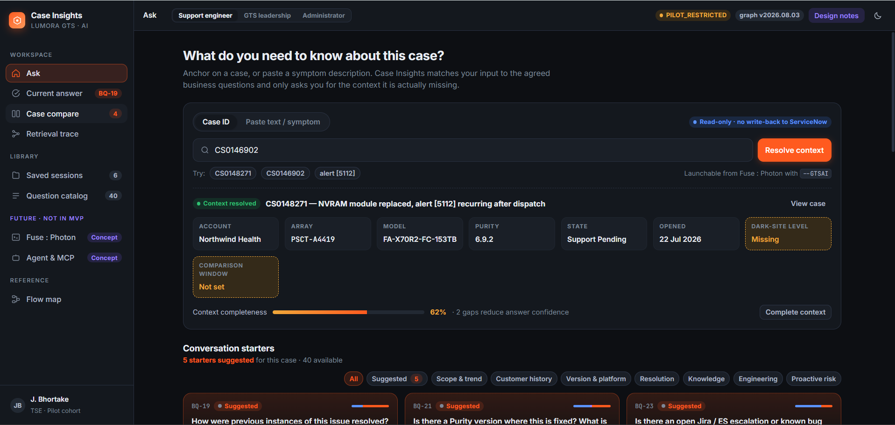

# Dashboard-UX

Clickable UX prototype of **Lumora Case Insights**, an AI assistant that helps support engineers answer agreed business questions about a case, with cited evidence, side-by-side case comparison and retrieval traces. It also has leadership and administrator views.



## Run it

```
node serve.mjs
```

Then open http://localhost:4173. No install step and no dependencies.

The page is a single file, `case-insights.html`. It has no `<html>`/`<head>`/`<body>` of its own because it is written as an Artifact page; `serve.mjs` wraps it in the same document skeleton for local preview.

## What is in the prototype

- **Ask**: anchor on a case or pasted text, resolve context, pick from 40 agreed business questions
- **Answer**: threaded turns with citations, evidence, compare tray, and trace and policy
- **Library**: saved sessions and the question catalog
- **Leadership** and **Administrator** views
- **Concepts** (not in MVP): Fuse : Photon CLI and Agent & MCP
- **Design notes** button hides requirement codes and rationale for a product-only view

All data is made up. Some answers are scripted, and buttons that are not wired say so when clicked.
